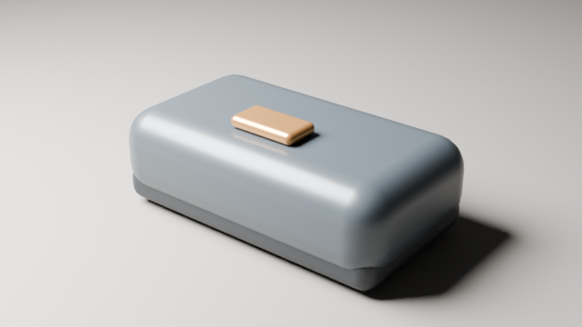
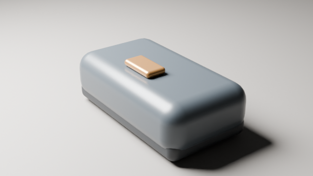

# Studio validation preview — 0.7.0

Built on `codex/step-1-decisions-memo` in the Trostky1 fork. No upstream push.
The one-page decision memo preceded implementation. This report records actual
evidence, not a declaration that every production-release gate is complete.

## Implemented

- Claude/Codex adapters, strict shared nested schema, owned conversation,
  explicit quota switch, cancellation, offline guard, sign-in probes, usage and
  latency capture. API-key overrides are stripped. No SDK or credential reads.
- Session-isolated, token-paired loopback companion and stdio MCP shim. Host,
  Origin, token, body size, queue size and timeouts checked. Main-thread dispatch;
  MCP only reads and stages. Per-session connection folder has owner permissions
  (POSIX mode or Windows ACL). No scene-apply MCP tool.
- Atomic versioned sidecar writes with backup, cross-process locking and stale
  revision refusal. Conversation, notes, storyboard, proposal and history audit.
- Part/surface notes, render-pixel Object Index mapping, note requests linked to
  staged proposals, explicit before/after capture links and user-set statuses.
- Numbered storyboard, revision approval, background copy render queue, ordered
  PNG sequence, EXR index/light groups and MP4 preview. Scale-relative push/orbit
  motion; no changes to the open product scene during rendering.
- Mirror-solved LightPaint placement, seeded studio recipe, measured image/scene
  checks, manual visual QA, a three-request critique cap, approximate captured-light
  Finish preview and guarded stage, reviewed Pack with hashes/contact sheet/stills.

## Evidence

Windows, Blender **5.3.0**, build `02f0899d78e3`. Commands use
`blender --background --factory-startup --python-exit-code 1 --python tests/<file>.py`.

| Suite | Result |
|---|---|
| test_headless | 28 checks passed |
| test_history | 28 passed |
| test_generate | 38 passed |
| test_backends | 25 passed, real runner with fake Claude/Codex |
| test_materials | 40 passed |
| test_quality | 12 passed |
| test_scene | 105 passed |
| test_presets | 31 passed |
| test_styles | 18 passed |
| test_refmatch | 13 passed, rendered measured-fit/apply/undo |
| test_panels_draw | 3,074 RNA-checked layout calls, including Studio board |
| test_studio, transport pass | 29 passed before later review controls were added |
| test_studio, final artifact pass | 25 passed with `C2B_SKIP_TRANSPORT=1`; includes MP4, EXR picking, Finish, Pack, repeated QA, note links and critique cap |
| test_scene_real | Skipped without its explicit live-provider opt-in; not counted as a pass |

The transport suite was run with approved local-server access. The final artifact
pass skipped transport because it changed artifact/review behavior, not HTTP
boundaries. Browser JavaScript passes `node --check`. `git diff --check` passes.
Headless tests do not certify modal 3D pin usability, image taste, or animation playback.

The original handheld demo (`tests/demo_studio.py`) exercises a known, inspected
note correction through Preview and Apply, then renders the owner's explicitly
approved 48-frame / 24 fps / 640×360 / 15° orbit. All frames and MP4 were written.
First and last frames were visually inspected; this is not a live-AI correction
or a production-quality acceptance. The saved editable scene and render outputs
are under ignored `tests/out/studio-demo/`.

## Boundaries still open

- Real four-call CLI staging smoke was prepared but automatic approval review
  hit its usage limit; calls were not executed. The earlier Codex image/schema
  smoke and partial experiment used real CLI calls, but do not substitute for it.
- Full two-backend experiment incomplete; see VISION_EXPERIMENT.md.
- Codex restricted-read isolation unverified. Read-only is not a privacy guarantee.
- No macOS runtime or older Blender 5.x runtime available for verification.
- Exact undo is session-only. Persisted audit metadata does not restore snapshots.
- Companion pairing/note save were checked at desktop and 390px. A fresh reviewer
  found three functional issues; source fixes were made. Expanded Finish/QA/Pack
  screens still need recapture because the browser tool became unavailable.
- Finish preview is approximate sRGB, not an exact AgX/compositor preview. It
  checks captured light energies, not every change to geometry/shaders since capture.
- Scene signature catches common stale requests, not arbitrary mesh-coordinate
  edits or every node-tree dependency. Existing Apply guards remain authoritative.
- Noise is not inferred from a single denoised frame. Missing independent noise
  samples and aesthetic questions remain explicit visual-review requirements.
- Storyboard motion supports hold/push/orbit and straight cuts. Connected graphic
  transitions, reliable shot-to-shot continuity and production brand taste need review.
- JSON migrates on Save As, but captured artifacts are not silently copied; rerender
  in the new sidecar. Pack does not redistribute textures, HDRIs or the source blend.

These are release gates and known limits. Use HANDOFF_BLOCKERS.md for the next pass.
